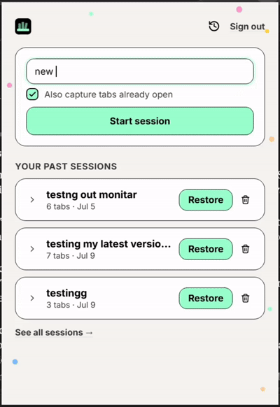

# Monitar

[](https://github.com/bowale-os/monitar/actions/workflows/ci.yml)
  
[](https://chromewebstore.google.com/detail/monitar/fmglkkadhimdlbpkbabbiigkbnpkdblc)

**A private memory for your research sessions.** Monitar is a Chrome extension that records the tabs you open during a browsing session, then lets you find that session again later by describing it in plain language. Your session contents are encrypted in your browser before they ever leave it, so the server stores data it cannot read.

[Install from the Chrome Web Store](https://chromewebstore.google.com/detail/monitar/fmglkkadhimdlbpkbabbiigkbnpkdblc)

<p align="center"></p>

## Why it exists

- **Privacy first.** Session contents (titles, URLs) are encrypted client-side with AES-256-GCM. The key is derived from your password with PBKDF2 and never sent to the server. A database leak exposes ciphertext, not your browsing history.
- **Semantic search, computed locally.** Embeddings are generated inside the extension with `Xenova/all-MiniLM-L6-v2` running on ONNX/WebAssembly. No page text is sent to a third-party AI API.
- **Convenient.** Start a session, browse, and Monitar tracks the tabs for you. Later, search "that article about vector databases" and get the session back, with keyword search over tab titles and URLs as a fallback.

## How it works

```
 Chrome extension (MV3)                          FastAPI backend            MongoDB
 ----------------------                          ---------------            -------
 track tabs in a session
 build text -> embed locally (MiniLM, 384-d)
 encrypt session (AES-GCM, PBKDF2 key)  ---->   /store  (auth required) --> ciphertext + embedding
 search: embed query locally            ---->   /search (cosine similarity
                                                  over embeddings)      <-- ranked session ids
 decrypt matches locally                <----   /{session_id}
```

The server sees only: an encrypted blob, a content hash, an embedding vector, tab/window counts and timestamps. Auth uses bcrypt-hashed passwords, short-lived JWT access tokens and rotating, server-revocable refresh tokens.

For sequence diagrams of every flow, the data model and the known trade-offs (including what the server can see), read [docs/ARCHITECTURE.md](docs/ARCHITECTURE.md).

| Layer | Stack |
|-------|-------|
| Extension | Manifest V3, vanilla JS, Web Crypto API, Transformers.js (ONNX Runtime Web) |
| Backend | Python 3.12, FastAPI, Pydantic, Authlib, python-jose, bcrypt, NumPy |
| Database | MongoDB (async PyMongo), TTL index for expired refresh tokens |
| Tests / CI | pytest + pytest-asyncio + pytest-cov, Vitest, GitHub Actions |
| Lint / types | ruff, mypy, ESLint |

## Run it locally

### Backend

Prerequisites: Python 3.12 and a MongoDB connection string. Either option works:

- A free [MongoDB Atlas](https://www.mongodb.com/atlas) cluster (no install). Paste its `mongodb+srv://...` URI into `MONGODB_CONNECT`.
- [MongoDB Community Server](https://www.mongodb.com/try/download/community) installed locally, with `MONGODB_CONNECT=mongodb://localhost:27017`.

```bash
pip install -r backend/requirements.txt
cp backend/app/.env.example backend/app/.env     # then set SECRET_KEY (>= 32 chars)
uvicorn backend.app.main:app --reload
```

Interactive API docs are at http://127.0.0.1:8000/docs. Google credentials in `.env` are only needed for Google sign-in.

Try the auth flow:

```bash
curl -X POST http://127.0.0.1:8000/sign-up -H "Content-Type: application/json" \
  -d '{"name":"Ada","email":"ada@example.com","password":"correct-horse-battery"}'
```

The response contains an access token, a refresh token and the per-user key salt used for client-side encryption.

### Extension

1. Open `chrome://extensions` and enable **Developer mode**.
2. Click **Load unpacked** and select the `frontend/extension` folder.
3. Point `API_BASE` in `frontend/extension/api.js` at `http://127.0.0.1:8000` (it defaults to the production API) and add that origin to `host_permissions` in `manifest.json`.

Or skip all of this and install the published build from the [Chrome Web Store](https://chromewebstore.google.com/detail/monitar/fmglkkadhimdlbpkbabbiigkbnpkdblc).

> `frontend/uploadzip/extension` is the copy packaged for the store and must stay byte-identical to `frontend/extension`. A test enforces this.

## Tests

```bash
# backend: auth routes, JWT/refresh security, dependencies, route registration
pytest

# extension: pure helpers (search, date formatting, escaping) and copy-sync check
cd frontend && npm install && npm test
```

The backend suite enforces 100% line coverage of the app code (`.coveragerc`), and dependencies are pinned in `backend/requirements.txt`.

Backend tests that need MongoDB use a throwaway `monitar_test` database and are skipped if `MONGODB_CONNECT` is unset. Every push and pull request runs both suites in GitHub Actions against a MongoDB service container.

## Code quality

CI runs all of these on every push and pull request:

| Check | Command | Config |
|-------|---------|--------|
| Python lint | `ruff check .` | [pyproject.toml](pyproject.toml) |
| Python types | `mypy` | [pyproject.toml](pyproject.toml) |
| JS lint | `cd frontend && npm run lint` | [frontend/eslint.config.js](frontend/eslint.config.js) |
| Backend tests | `pytest --cov=backend/app` | [pytest.ini](pytest.ini), [.coveragerc](.coveragerc) (100% required) |
| Extension tests | `cd frontend && npm test` | Vitest |

Install the Python dev tools with `pip install -r requirements-dev.txt`. The lint rules are intentionally conservative (pyflakes and pycodestyle errors), and mypy runs in a lenient mode.

## Sample outputs and benchmarks

Both are reproducible. They run the real FastAPI handlers and the real `crypto.js` against an in-memory stand-in for MongoDB, so no database is needed.

### Sample API responses

```bash
python scripts/sample_outputs.py
```

Tokens and ciphertext are truncated. Embeddings are 4-d here for readability (384-d in production). The search query is about embeddings, and "Vector databases research" ranks first.

**Sign up**

```
POST /sign-up -> 201
{
  "message": "You signed up successfully",
  "access_token": "eyJhbGciOiJIUzI1NiIsInR5...",
  "refresh_token": "HTyTlCQE9Ayk2E3D1vzdBH8y...",
  "enc_salt": "grSnLnjSNDIs9Np5LA7+yQ=="
}
```

**Store a session**

```
POST /store -> 201
{
  "message": "This session was stored successfully",
  "id": "2a12ea0c-98e5-4b6b-83ef-27b235066602"
}
```

**Semantic search (query about embeddings)**

```
POST /search -> 200
{
  "data": [
    {
      "_id": "2a12ea0c-98e5-4b6b-83ef-27b235066602",
      "intent": "Vector databases research",
      "started_at": "2026-10-19T09:30:00+00:00",
      "tab_count": 6,
      "window_count": 1,
      "score": 0.983993411064148
    },
    {
      "_id": "083966e0-b3d0-41dc-a971-c9af3d1b217d",
      "intent": "Sourdough baking",
      "started_at": "2026-10-19T09:30:00+00:00",
      "tab_count": 6,
      "window_count": 1,
      "score": 0.3542199730873108
    }
  ]
}
```

**Reuse the rotated-out token**

```
POST /refresh -> 401
{
  "detail": "Invalid or expired refresh token"
}
```

### Benchmarks

```bash
python scripts/bench_search.py     # POST /search over N stored sessions
node scripts/bench_crypto.mjs      # AES-256-GCM and PBKDF2 from crypto.js
```

```
POST /search, 384-d embeddings, 20 runs each
 sessions | median ms |   p95 ms
      100 |      2.37 |     3.30
     1000 |     23.54 |    40.17
     5000 |    117.27 |   168.01
```

```
Node v24.13.1
PBKDF2 key derivation (100k iters) median    26.12 ms
encrypt    10 tabs (2 KB)          median     0.28 ms
decrypt    10 tabs                 median     0.15 ms
hashPayload   10 tabs              median     0.09 ms
encrypt   100 tabs (23 KB)         median     1.37 ms
decrypt   100 tabs                 median     0.31 ms
hashPayload  100 tabs              median     0.17 ms
encrypt  1000 tabs (230 KB)        median    13.07 ms
decrypt  1000 tabs                 median     2.32 ms
hashPayload 1000 tabs              median     1.39 ms
```

Measured on a Windows 11 laptop with Python 3.12 and Node 24. Treat the numbers as indicative, not as guarantees:

- The search benchmark excludes MongoDB network and decoding time, so it is a lower bound. Search is an exact linear scan, so latency grows linearly with stored sessions.
- Embedding time for MiniLM runs in Chrome (ONNX/WASM) and is not measured here.

## Repository layout

```
backend/app/
  api/         auth, storage, retrieval routes
  models/      Pydantic models (User, Session, Tab)
  services/    MongoDB and Google OAuth clients
  tests/       pytest suite
frontend/
  extension/   Chrome extension source (popup, background worker, crypto, embeddings)
  tests/       Vitest suite
docs/          ARCHITECTURE.md and demo assets
scripts/       sample_outputs.py, bench_search.py, bench_crypto.mjs
```

## Privacy

The privacy policy is served by the backend at `/privacy`.

## License

Copyright (c) Daniel Sobowale. All rights reserved. This repository is public for viewing and evaluation only; no license to use, copy, modify or distribute the code is granted.
