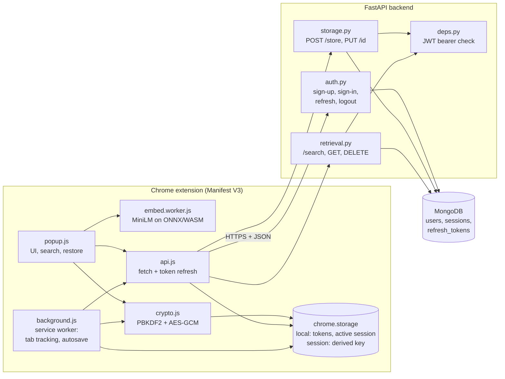
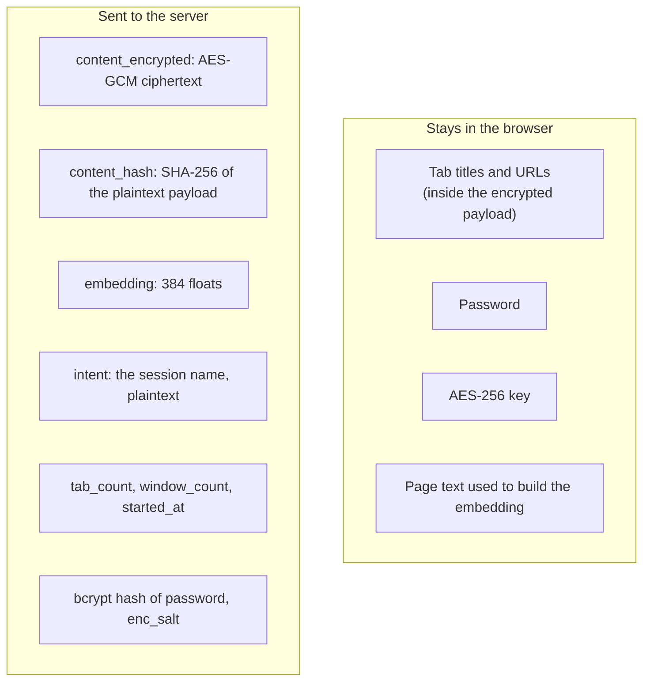
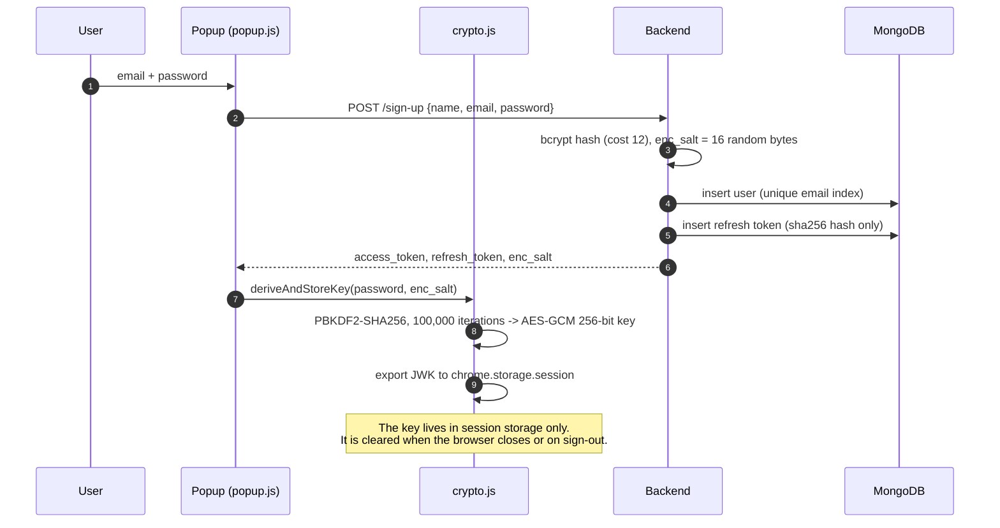
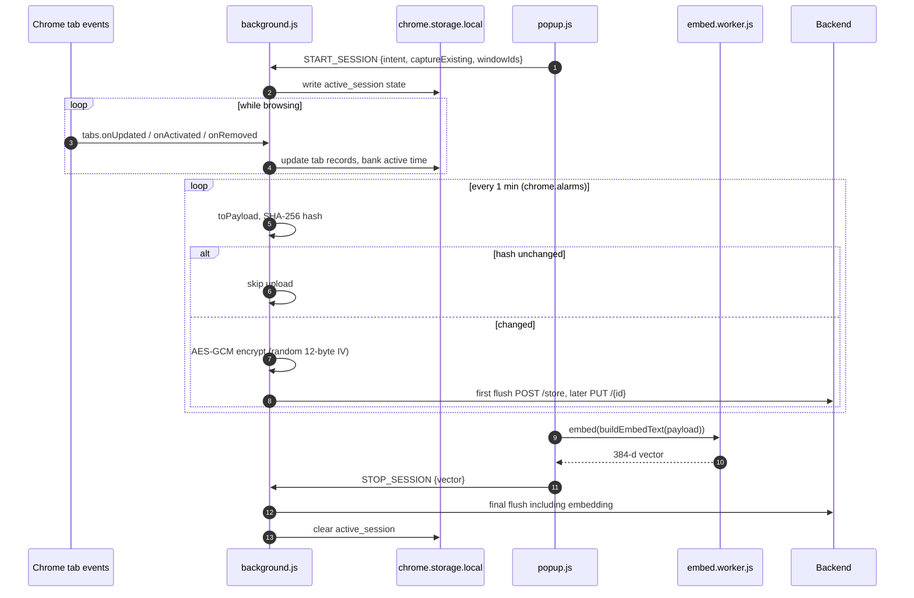
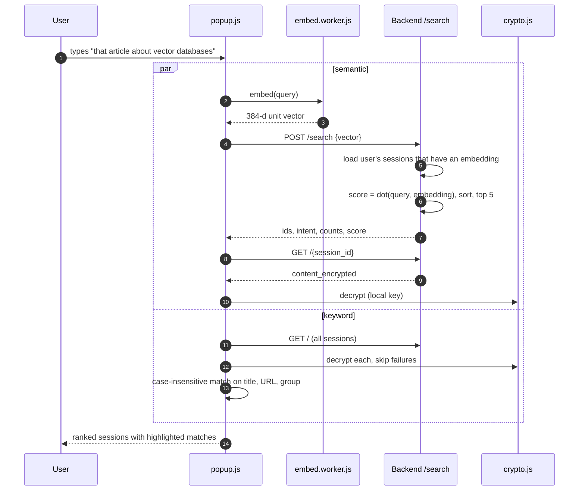
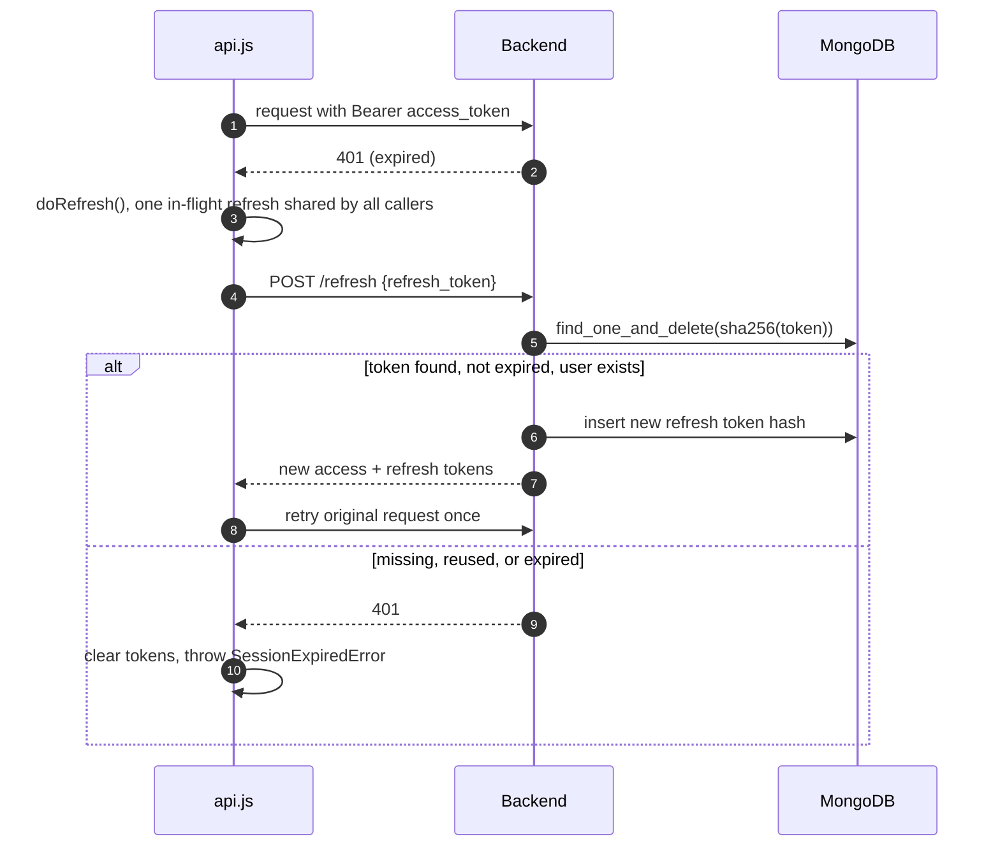
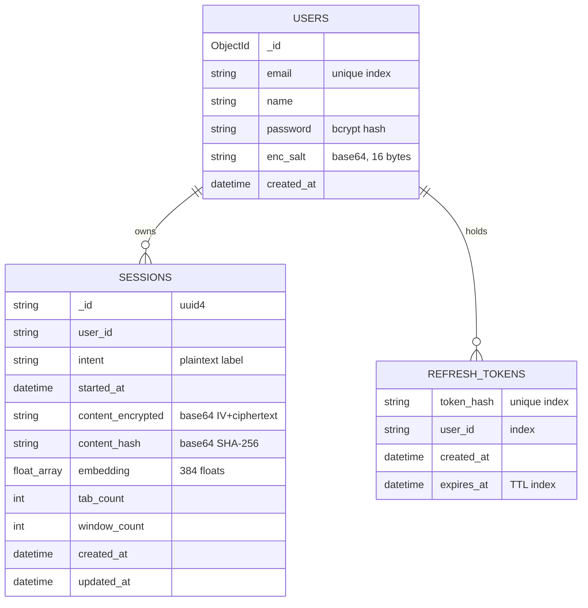

# Architecture

How Monitar works end to end: what runs where, what the server can and cannot see, and why the main decisions were made. Every diagram below reflects the current code.

## 1. System overview

| Component | Responsibility | Source |
|-----------|----------------|--------|
| Popup | Start/stop sessions, search, restore, account UI | `frontend/extension/popup.js` |
| Service worker | Records tab events, accumulates time per tab, autosaves every minute | `frontend/extension/background.js` |
| Embed worker | Loads `Xenova/all-MiniLM-L6-v2` (quantized) and returns 384-d normalized vectors | `frontend/extension/embed.worker.js` |
| Crypto | Key derivation, AES-GCM encrypt/decrypt, payload hash | `frontend/extension/crypto.js` |
| API client | Bearer auth, single-flight refresh-token rotation, retry on 401 | `frontend/extension/api.js` |
| Backend | Auth, per-user storage of opaque blobs, vector search | `backend/app/` |

## 2. What the server can and cannot see

Be precise about the boundary:

- **Hidden from the server:** tab titles, URLs, group names, per-tab timings (all inside the ciphertext), and the AES key.
- **Visible to the server:** the session `intent` (a short label you type), counts, timestamps, the embedding, and the content hash. The password is also visible transiently at sign-in, because it is sent over TLS to be bcrypt-verified (see section 3).
- **The embedding is a deliberate leak.** Server-side semantic search needs plaintext vectors. A 384-d embedding of "Intent, Topics, Sites, Pages" text reveals the rough subject of a session, and embeddings can sometimes be partially inverted. The ciphertext protects exact URLs and titles, not the topic. See [Limitations](#8-limitations-and-trade-offs).
- **The content hash** lets the extension skip uploads when nothing changed. It is a SHA-256 of a payload that includes titles and URLs, so it is not reversible in practice, but it does let the server detect that two saves are identical.

## 3. Sign-up and key derivation

The encryption key is derived from the password in the browser. The server only ever stores a bcrypt hash and a random per-user salt.

Sign-in follows the same shape. The server returns `enc_salt` with the tokens so a new device can re-derive the same key from the same password.

Design notes:

- The password goes to the server over TLS so it can be bcrypt-verified, and the same password also seeds the encryption key. This is a known compromise: a malicious or compromised server could capture the password at sign-in and derive the key. See [Limitations](#8-limitations-and-trade-offs).
- `chrome.storage.session` is memory-backed and not written to disk, which keeps the key out of persistent storage. The key is re-imported as non-extractable for each use (`loadKey`).
- bcrypt truncates at 72 bytes, so the schema caps passwords at 72 bytes (min 8) rather than letting truncation happen silently.

## 4. Saving a session

Key points:

- **State lives in storage, not memory.** MV3 service workers are killed when idle, so `background.js` reads and writes `chrome.storage.local` on every event and holds nothing in module scope.
- **Trackable tabs only.** Only `http(s)` URLs are recorded. `chrome://` and extension pages are skipped.
- **Embedding input** (`buildEmbedText` in `helpers.js`) is `Intent`, group names, unique hostnames, and cleaned tab titles, capped at 1,000 characters. Junk titles such as "New Tab" are dropped.
- **Wire format** of `content_encrypted` is `base64( IV[12] || ciphertext+tag )`, where the plaintext is the JSON session payload (windows, tabs, groups).
- **Autosave** sends no embedding unless one is supplied. The vector is computed when the session stops, so a session that is still running (or killed mid-way) is stored but is not yet semantically searchable. Keyword search still finds it.

## 5. Finding a session

Search has two independent paths. Semantic search runs on the server over embeddings. Keyword search runs entirely in the browser over decrypted content.

How scoring works:

- The extension L2-normalizes vectors (`normalize: true`), and the server normalizes the query again. The stored vectors are assumed to be unit length, so a dot product equals cosine similarity.
- The server filters by `user_id` first, so one user's query never scores another user's sessions.
- Search is an exact linear scan with NumPy, with no ANN index. It is simple and correct, and fast at personal scale. Measured numbers are in the [README benchmarks](../README.md#sample-outputs-and-benchmarks).
- Decrypted session payloads are cached in `chrome.storage` under `search_decrypt_cache_v1` so the popup does not re-decrypt on every open. Only successful decrypts are cached.

## 6. Token lifecycle

Access tokens are short-lived JWTs. Refresh tokens are opaque random strings that rotate on every use.

| Property | Choice | Reason |
|----------|--------|--------|
| Access token | JWT HS256, 15 min, `type: "access"`, random `jti` | Short blast radius if stolen. The `type` claim stops other token kinds being accepted as access tokens. |
| Refresh token | `secrets.token_urlsafe(32)`, 7 days | High entropy, so a fast hash is safe at rest. |
| Storage | Only `sha256(token)` in MongoDB | A database leak does not yield usable tokens. |
| Rotation | `find_one_and_delete` | Atomic consume: of two concurrent refreshes, only one wins. A replayed token fails because it no longer exists. |
| Cleanup | TTL index on `expires_at` | MongoDB purges expired tokens automatically. The route also checks expiry in case the TTL sweep has not run. |
| Logout | `POST /logout` deletes the token | Server-side revocation, with local tokens cleared regardless. |
| Enumeration | One identical 401 for unknown email and wrong password | Prevents discovering which emails are registered. |

## 7. Data model

Every session query includes `user_id` taken from the verified JWT, never from the request, so `GET`, `PUT`, `DELETE` and `/search` are scoped to the caller. A request for another user's session id returns 404.

## 8. Limitations and trade-offs

These are known and deliberate, not oversights.

1. **Embeddings leak topic.** Needed for server-side search. The alternative is client-side search over all decrypted sessions, which does not scale and would need every session downloaded. Keyword search already works that way.
2. **Password doubles as the key seed.** The server sees the password at sign-in. A zero-knowledge design would use a separate login secret (OPAQUE or a split derivation). It was left out to keep sign-in simple.
3. **No recovery of data after a password loss.** The key comes from the password and the salt. A forgotten password means the ciphertext cannot be recovered, and a password reset would orphan existing sessions unless the data were re-encrypted.
4. **PBKDF2 at 100,000 iterations** is below current OWASP guidance for SHA-256. It was chosen for popup responsiveness (about 30 ms in Node, see the README) and is a candidate to raise. Changing it needs a versioned parameter stored with the user.
5. **`intent` is plaintext.** It powers the session list and search results without a decrypt. Users should not put secrets in it.
6. **Linear-scan search.** Cost grows linearly with the number of embedded sessions. It is fine into the low thousands and would need an index (MongoDB Atlas Vector Search or an ANN library) beyond that.
7. **Open CORS.** `allow_origins=["*"]` with `allow_credentials=False`. Auth is a bearer header, not a cookie, so this does not open a CSRF path, but it could be narrowed to the extension origin.
8. **Model download.** The ONNX runtime is bundled, but the MiniLM weights download from HuggingFace on first use and are then cached by the browser. No page content is sent there.

## 9. Design decisions

Each entry records the situation, the options weighed, what was chosen, and what that costs.

### D1. Compute embeddings in the browser

- **Context:** Semantic search needs a vector per session. Sending page text to a hosted embedding API would expose browsing content to a third party.
- **Options:** (a) hosted API such as OpenAI or Vertex, (b) run a small model on the backend, (c) run a small model in the extension.
- **Decision:** (c), `Xenova/all-MiniLM-L6-v2` quantized, on ONNX/WASM in a worker.
- **Consequences:** No third party sees titles or URLs, and there is no per-request cost. The price is a first-run model download, single-threaded inference (extension pages lack cross-origin isolation), and a smaller model than a hosted API would offer.

### D2. Encrypt in the browser with a password-derived key

- **Context:** A database leak should not expose browsing history.
- **Options:** (a) server-side encryption at rest only, (b) a random key stored with the account, (c) a key derived from the password in the client.
- **Decision:** (c), PBKDF2-SHA256 into AES-256-GCM, with a per-user salt held by the server.
- **Consequences:** The server stores ciphertext it cannot decrypt, and any device with the password can read sessions. The cost is that a forgotten password makes the data unrecoverable, and the password also reaches the server at sign-in (see section 8).

### D3. Ship plaintext embeddings alongside ciphertext

- **Context:** Ranking on the server needs readable vectors, but readable vectors leak the topic of a session.
- **Options:** (a) no semantic search, only client-side keyword search, (b) download and decrypt everything to rank locally, (c) store the embedding in plaintext.
- **Decision:** (c) for semantic search, with keyword search kept fully client-side as a complement.
- **Consequences:** Search stays fast and the payload stays private, but topic-level information is visible to the server. This is stated openly in the README and in section 2.

### D4. Exact linear scan instead of a vector index

- **Context:** Each user has dozens to low thousands of sessions.
- **Options:** (a) NumPy dot product over the user's sessions, (b) Atlas Vector Search, (c) an ANN library such as FAISS or hnswlib.
- **Decision:** (a).
- **Consequences:** Exact results, no extra infrastructure, and latency in the tens of milliseconds at 1,000 sessions (see the README benchmarks). It grows linearly, so it is the first thing to replace if usage grows far beyond personal scale.

### D5. Short-lived JWTs plus rotating, hashed refresh tokens

- **Context:** The extension needs to stay signed in for days without keeping a long-lived bearer secret that works forever.
- **Options:** (a) one long-lived JWT, (b) a session cookie, (c) 15-minute access JWT with a rotating opaque refresh token.
- **Decision:** (c), with refresh tokens stored only as SHA-256 hashes, consumed atomically on use, and purged by a TTL index.
- **Consequences:** A stolen access token expires quickly, a leaked database yields no usable refresh tokens, and a replayed token fails. The client must handle refresh races, which `api.js` does with a single shared in-flight refresh.

### D6. Keep all session state in `chrome.storage`

- **Context:** MV3 service workers are suspended when idle and restarted on events, so module-level variables disappear without warning.
- **Options:** (a) keep state in memory and rebuild on wake, (b) persist every change to storage.
- **Decision:** (b). `background.js` reads state at the start of each event and writes it back at the end, and autosave uses `chrome.alarms`, which survives suspension.
- **Consequences:** Tracking survives worker restarts and popup closes. The cost is more storage reads and writes, and every handler must be written as read, modify, write.

### D7. Hash-gated, full-envelope autosave

- **Context:** A session is saved every minute, but most minutes nothing changes.
- **Options:** (a) upload on every tick, (b) send diffs, (c) upload the whole encrypted envelope only when the content hash changes.
- **Decision:** (c).
- **Consequences:** Simple server logic (one `PUT` that overwrites) and no wasted uploads. Diffs would be smaller on the wire but cannot work well over ciphertext, since one change re-encrypts the whole payload anyway.

### D8. Two search engines merged in the popup

- **Context:** Semantic search finds related topics but can miss an exact URL fragment, and keyword search is the reverse.
- **Options:** (a) semantic only, (b) keyword only, (c) both in parallel with de-duplication.
- **Decision:** (c). Keyword results render first with highlighting, and semantic-only matches follow, labelled as related by topic.
- **Consequences:** Better recall, and either engine can fail without breaking search. Keyword search decrypts every session, so a per-session decrypt cache in `chrome.storage.session` keeps it fast.

### D9. A byte-identical store-packaging copy of the extension

- **Context:** The Chrome Web Store upload lives in `frontend/uploadzip/extension`, separate from the development copy.
- **Options:** (a) a build step that generates one from the other, (b) a manual copy guarded by a test.
- **Decision:** (b). A Vitest check fails CI if the two directories differ.
- **Consequences:** No build tooling for a vanilla-JS extension, at the price of editing both copies. A build step becomes worthwhile if the extension grows a bundler.

## 10. Testing and quality

| Layer | Tooling | What it covers |
|-------|---------|----------------|
| Backend tests | pytest, pytest-asyncio, pytest-cov | Auth routes, JWT and refresh security, dependencies, route registration, sessions. 100% line coverage enforced in CI. |
| Extension tests | Vitest | Pure helpers (search, date formatting, escaping, embed text) and a test that the two extension copies stay byte-identical. |
| Lint and types | ruff, mypy, ESLint | Run in CI on every push and pull request. |
| Scripts | `scripts/` | `sample_outputs.py`, `bench_search.py`, `bench_crypto.mjs`. |
